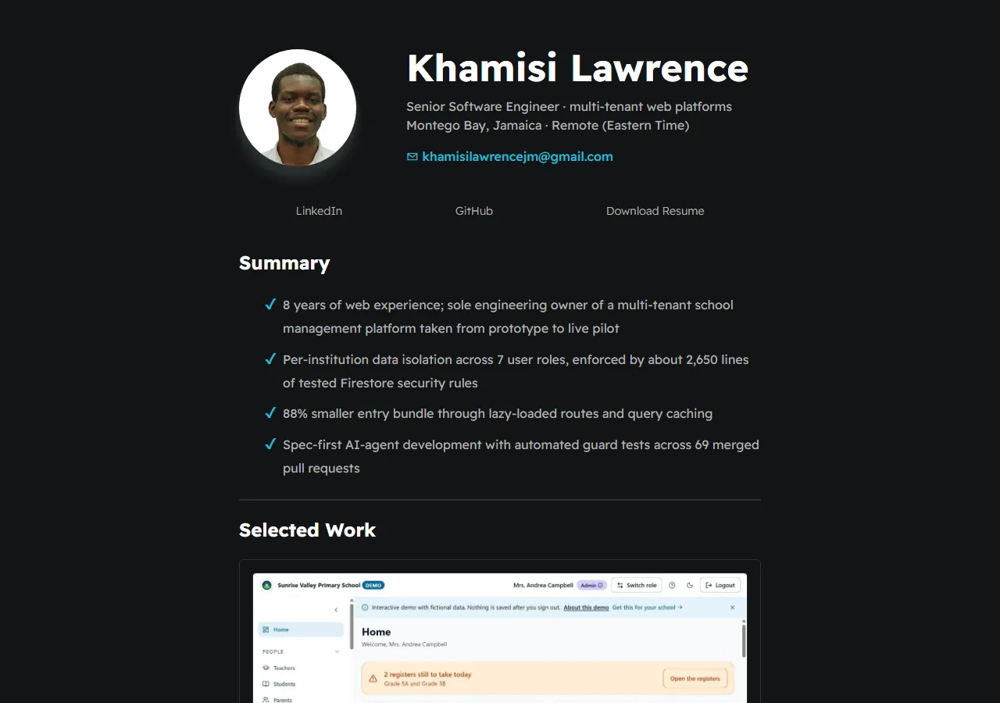

# [Resume Website of Khamisi Lawrence](https://khamisilawrence.github.io/)

Portfolio and resume site of Khamisi Lawrence, Senior Software Engineer: selected work, experience, how I work, tech stack and certifications.

## Editing content
Page sections are rendered by `scripts/main.js` from the JSON files in `assets/data/`:
- `experience.json`: roles; an entry with only a `note` field renders as a single italic line.
- `projects.json`: Selected Work cards; `image` and `imageAlt` are optional.
- `stack.json` and `certifications.json`: a certification without a `link` renders as plain text.

## Credits
- This project was completed following guidance provided by a 70-minute [YouTube video](https://youtu.be/clwpf3VwCZQ) uploaded by [Traversy Media](https://www.youtube.com/@TraversyMedia/) on the 11th of August 2022, titled “Build A Digital Resume & Host For Free”.
- The styling used in this project was inspired by [Dennis Ivy's Digital-Resume Github repository](https://github.com/divanov11/Digital-Resume).
